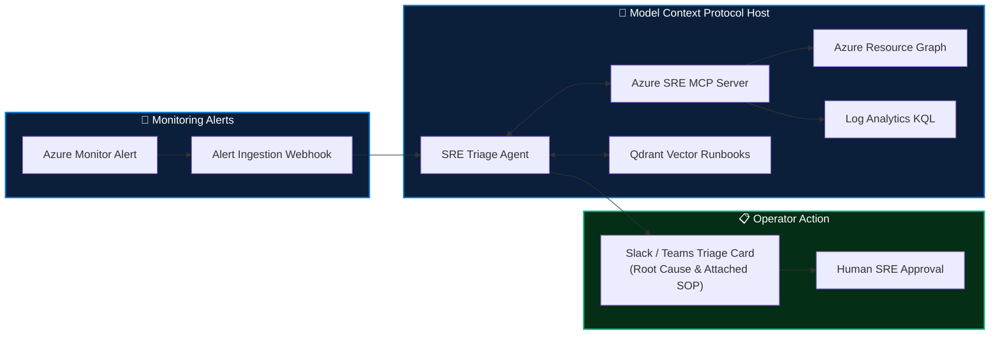

<div align="center">

# 🤖 Intelligent SRE Co-Pilot (Model Context Protocol & RAG)

[-00599C?style=for-the-badge&logo=anthropic&logoColor=white)](#)
[](https://python.org)
[](#)
[](#)

**Autonomous SRE operations co-pilot integrating Anthropic's Model Context Protocol (MCP) with Azure Cloud telemetry and Vector Runbook RAG to accelerate incident response.**

</div>

---

## 🎯 Architectural Philosophy

AI assistance in production operations must be **strictly bounded and read-only**:
- 🔌 **Model Context Protocol (MCP):** Connects LLMs (Claude, GPT) directly to live infrastructure diagnostics via standardized JSON-RPC interfaces.
- 🔒 **Zero Write Permissions:** AI agents can query Resource Graph, execute Log Analytics KQL, and inspect state, but **never execute mutating cloud actions directly**.
- 📚 **Vector Runbook RAG:** Embeds incident post-mortems and SOP runbooks into Qdrant for real-time semantic correlation during on-call alerts.
- ⚡ **Measurable SRE Impact:** Reduces Mean Time to Acknowledge & Diagnose (MTTA) by **40%**, delivering pre-correlated diagnostic summaries directly to on-call engineers.



---

## 📁 Repository Structure

```
.
├── server/
│   └── mcp_server.py      # Read-only Model Context Protocol server for Azure telemetry
├── agent/
│   └── sre_agent.py       # Multi-agent alert correlation and SOP runbook matcher
└── README.md
```

---

## 👤 Author

**Sujeet Kumar**  
*Senior DevSecOps Engineer & Enterprise Cloud Architect (17+ Years Experience)*  
[](https://linkedin.com/in/sujeetkumar122)
[](https://github.com/Sujeetkumar122)
